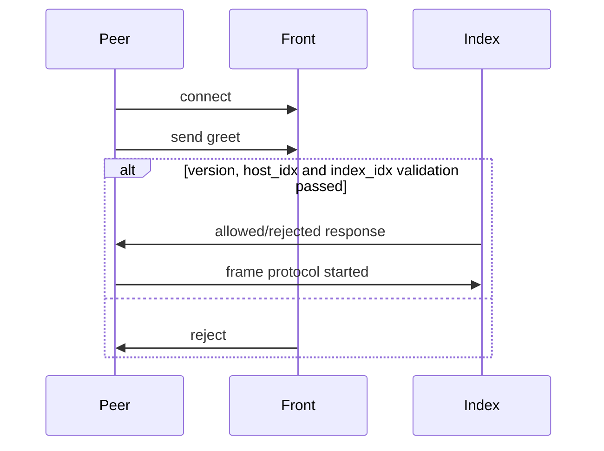

# Iteration 2

- **Subject:** consensus-topology
- **From:** planner
- **U resolved:** U1, U2, U3, U4, U5, U6, U7, U8, U9, U10, U11, U12, U13, U14, U15, U16
- **U open:** U17, U18, U19, U20, U21, U22
- **Next:** The pad settles the accept-side greeting order, the reorder geometry, the pulse's proof of life, the two
  capacity bounds, the code map and the unread image; iteration 3 then compiles the topology, the link lifecycle and the
  transport stub into `docs/CONSENSUS-TOPOLOGY-AND-TRANSPORT.md` and pins the implementation surface named here.

Iteration 1's pad is filled in full and carries no `# Critical` section. All sixteen questions are answered. Six answers
change the plan rather than extend it, and one pair of answers cannot both hold; this letter records the first six as
fact and re-opens the inconsistency as U17. No code is written in this iteration: the deliverable is still the plan, and
`docs/CONSENSUS-TOPOLOGY-AND-TRANSPORT.md` stays byte-identical until the pad closes and the thread promotes. Line
references were re-verified against the working tree (HEAD `b333141`, no `src/` modifications, the design document and
`image.png` untracked).

## 1. The answers, and what they change

| U   | answer, as fact                                                                                                                                     |
| --- | --------------------------------------------------------------------------------------------------------------------------------------------------- |
| U1  | This document is the prelude. It fixes the topology, the link lifecycle, the transport's requirements, the op-code number space and its ranges.     |
| U2  | A `cluster` block names `peer_port` and `peers[host_idx]`; the peer listener binds `bind:peer_port`; `hosts == 1` removes the block and the socket. |
| U3  | A separate peer listener; the client path is untouched. The client protocol is data plane, the peer protocol is control plane.                      |
| U4  | A peer socket is always handed over as a slot plus an io_uring message, never through the index inbox.                                              |
| U5  | The byte layout of the frame is a stub, to be fixed in a later transport-format document.                                                           |
| U6  | The envelope is `(no_of_decisions: uvarint, start_state_idx: u128, decisions: bitmap)`, bit `i` LSB-first; `0` decisions is one zero byte.          |
| U7  | `seq_id` is per direction, per connection; every inbound frame goes through `zigring.ReorderBuffer`.                                                |
| U8  | The 5-byte identity exchange `(version: u16, host_idx: u8, index_idx: u16)`; both sides validate it; a mismatch closes the link.                    |
| U9  | A duplicate is resolved by the predicate FSM: pulse the existing link, replace on error or timeout, reject the candidate otherwise.                 |
| U10 | Dialling is non-blocking and tracked in `Slots`; retry with exponential backoff; never fatal.                                                       |
| U11 | The vector-clock entry is the **last sent** state for that host, not the applied or the durable one.                                                |
| U12 | The commit envelope is the **leader's** aggregated status, not the receiver's acknowledgement; the reply is ordered and stamped with `seq_id`.      |
| U13 | Little endian, packed, `blog.append`/`appendVarint`, no checksum, version only in the exchange, reserved op ranges, unknown op closes the link.     |
| U14 | A send's buffer waits for its CQE; the operation context lives in `Slots`.                                                                          |
| U15 | The control plane is `src/cluster_transport.zig`; consensus is built over it later.                                                                 |
| U16 | Teardown closes links on drain, hard shutdown closes at once, no goodbye op; the lower host redials.                                                |

### 1.1 The six reversals against iteration 1

These are not extensions of iteration 1's text; they replace it, so the promoted document must not carry the older
wording.

1. **Hand-over is not an inbox message.** Iteration 1 proposed `FrontMessage.peer_link` and a `CrossTask.PeerLink` slot
   only when the target index belonged to another front. U4 makes it _always_ a slot plus a `MSG_RING` into the target
   index's ring. `FrontMessage` (`src/index.zig:21-36`) gains nothing; the inbox stays SPSC with exactly one producer,
   the owning front, and only client work uses it.
2. **The frame layout is not pinned.** Iteration 1 proposed a concrete field order with `payload_len: u32`. U5 demotes
   it to a stub. The logical frame survives; the byte layout, the payload cap and the chunking rules move to a later
   document.
3. **The vector clock is not "applied".** U11 answers "last sent": the frame reports the frontier of what the sender has
   already put on this link for that host. The WAL is append-only and never overwrites, so the frontier is a monotone
   promise the receiver may ask the sender to fulfil.
4. **The envelope is not the receiver's acknowledgement.** U12 makes it the leader's aggregate: the leader collects
   approvals and rejections in a strictly ordered stream, decides one op per quantum, and pushes the reply back; the
   reply keeps that order and is stamped with the right `seq_id`. Per-op approvals and rejections travel in the
   consensus payloads, not in the envelope.
5. **The new file is `src/cluster_transport.zig`.** It is the p2p transport; the consensus driver will be written over
   it, not inside it.
6. **There is no staging pool waiting to be sized.** A send's bytes are owned by the operation context until its CQE
   (`Slots`), and the link does not drop frames or fail on local contention; it applies backpressure.

### 1.2 The one answer that cannot stand as written

U8 was confirmed with the accepting side sending its identity "first, immediately after accept". U3 and U4, confirmed in
the same pad, require the front to read the dialer's identity before it can know which index owns the connection, and
the front must not become a second protocol writer on a socket it is about to hand over. The acceptor therefore cannot
send a 5-byte identity that contains `index_idx` before reading the greet. This is not a wording detail; it fixes the
wire order, the writer and the read lengths on both sides. It is re-opened as **U17** and the rest of this letter uses
the proposed order: greet first, then one 7-byte reply written by the owning index.

## 2. Scope and the document's place in the sequence

The document is the prelude: it fixes the plumbing the consensus driver will sit on, so the consensus document can
describe decisions without re-describing sockets, framing and catch-up requests. Its chapters are topology, link
establishment, the transport stub, the two pieces of cross-link semantics the stub must carry, and the implementation
surface. The consensus algorithm itself, the payload codecs, the snapshot contents and the WAL/state semantics the ops
mutate are the next document's, not this one.

Terminology is the code's, not invented: `index_count` is `cfg.indexes`, the number of index threads per host;
`replication_factor` is `cfg.wal.hosts()`, bounded to `1..=256` by the WAL API's `host_idx: u8`
(`src/config.zig:174-179`, `src/config.zig:638`); `host_idx` is `cfg.host_index`, validated `< hosts`; the index's own
number is `role.index.inbox_idx`, identical to `frame.index_idx` (`src/index.zig:50-51`, `src/index.zig:139`); a state
is the packed `u128` of `state.IndexState.state`, laid out as `(host_id: u8, index_id: u16, epoch_id: u40, index: u64)`
(`src/state.zig:155-163`).

The op-code number space and its ranges are fixed here (`0x00..0x1F` transport and catch-up, `0x20..0x7F` consensus,
`0x80..0xFF` unused). Which consensus op is which, and what its payload is, is the consensus document's. Snapshot and
catch-up transfers appear here only as a named family ("give me the data for host `h` from state `s`"); their payloads
and chunking are later.

The promoted document is written in English in place, replacing the Russian text of
`docs/CONSENSUS-TOPOLOGY-AND-TRANSPORT.md`. Until promotion that file is not edited. The older consensus documents are
stale and are not sources; the code and the Russian text are, plus this pad.

## 3. Topology

For index thread `i` on host `h`:

- it **dials** every host `j > h` and owns the resulting socket. The dial is a `pushConnectIp4` on the index's own ring
  (`Ring.pushConnectIp4`, `zigring` `iouring.zig:1174`), armed from the index's `run` loop (`src/index.zig:73-181`); no
  front is involved.
- it **accepts** nothing directly. A connection from `j < h` arrives at the process peer listener, is accepted by
  whichever front's multishot wins, and is handed to index `i` by the slot path of §4.2.
- it never talks to `host_idx == cfg.host_index`: there is no self-link. With `hosts == 1` the transport is dark: the
  `cluster` block is absent, no peer listener is created and no link is ever installed. With `hosts > 1` the block is
  required.
- a link is per `(index thread, peer host)` and is never multiplexed across index numbers. The same index number on both
  hosts is the pair (the WAL battery is indexed by `(host_idx, index_idx)`, and the group of index `i` is index `i` on
  every host). The frame therefore needs no index field, and the link needs no demux: the table slot the receive path
  runs in already names the pair.

One socket serves both directions, and the higher host answers on the same socket. The socket count is
`index_count * (replication_factor - 1)` per process, unchanged. An index has `replication_factor - 1` links and each
link has two independent directions, each with its own `seq_id` space and reorder buffer (U7).

The peer listener is process-wide, created by the process thread, and shared by every front exactly like the client
listener (`src/main.zig:170-173`, `src/lifetime.zig:1191-1219`). Each front arms a second multishot accept on it; an
accept on the same listening socket from several rings is the same shape the client path already uses. The listening
descriptor reaches the fronts before `START_WORK`, through the slot vocabulary, because `res` in the broadcast already
carries the client descriptor (`src/main.zig:301-314`).

## 4. Link establishment and hand-over

### 4.1 The greet (dialer)

After the connect completion succeeds, the index sends exactly five bytes, little endian and packed:

| `version: u16` | `host_idx: u8` | `index_idx: u16` |
| -------------- | -------------- | ---------------- |

`version` is a compile-time constant of `src/cluster_transport.zig`, bumped on an incompatible change. `host_idx` and
`index_idx` are the dialer's own. The dialer sends nothing else until it has read the acceptor's reply: not a frame, not
another byte. A failed connect is a retry, not a fatality (U10).

The greet is not a frame. It carries no `seq_id`, does not go through the reorder buffer, and is not subject to the
frame stub. Its fixed length is a property of v1; the version is its first field so an incompatible peer is detected
before any frame is parsed.

### 4.2 Front intake (U4)

The front that accepted the peer socket owns it only until the hand-over:

1. The peer accept CQE carries the descriptor in `res`, as the client path's does (`src/front.zig:143-176`). The front
   takes a handshake entry (U20), records the fd, and arms a one-shot receive for exactly five bytes with a deadline.
   The entry owns the five-byte request buffer and a seven-byte reply buffer, so the kernel's writes never target a loop
   frame. Partial reads are legal and re-arm for the remainder; EOF, a short read at the deadline, or an error closes
   the fd and releases the entry.
2. On five bytes, the front checks the version first, because a foreign version makes the rest of the greet's layout
   unknown and routing by a field at an unknown offset would be a bug. If `version != local`, it writes the 7-byte reply
   `(local version, local host_idx, 0xFFFF, version_mismatch)`, closes after that send's CQE, and never routes. If
   `index_idx >= cfg.indexes`, it does the same with `unknown_index`: there is no target ring. Otherwise it calls
   `std.posix.getpeername`, computes `source_ok` (true only when `host_idx < hosts` and the four address bytes match the
   parsed `cluster.peers[host_idx]`; an out-of-range host is `source_ok = false`, never an out-of-bounds index), and
   routes. Neither a version mismatch nor an out-of-range index is silently dropped; those two unroutable cases are the
   only replies the front writes, and it writes them only on a connection it will close instead of handing over.
3. The front acquires a `CrossTaskSlots` slot, writes `CrossTask.PeerLink`, and posts `MSG_RING` with
   `taskIdx = messages.CrossTaskMessageIdx` and `res = slot_idx` to `ctrl.rings[cfg.fronts + index_idx].ring.fd`. This
   is `snapshot.dispatch`'s exact shape (`src/snapshot.zig:360-386`): on `error.RingFull` the slot keeps its payload and
   the front retries the `MSG_RING` once per loop pass, never spinning the accept path (`src/snapshot.zig:390-406`).
4. The successful post is the ownership transfer. The front never reads, writes, closes or polls that fd again; the
   index becomes its only owner. A refused post keeps the fd and the slot in the handshake entry until it lands; a
   shutdown closes it before posting, so a closed fd is never handed over.

The target ring is the global index number plus `cfg.fronts`: `roleOf` gives index `k` the ring `cfg.fronts + k`
regardless of which front owns it (`src/lifetime.zig:1134-1160`). That is why the hand-over needs no `index_per_front`
arithmetic and why U4 can be "always message passing".

The `PeerLink` payload is `{ fd: posix.fd_t, host_idx: u8, index_idx: u16, version: u16, source_ok: bool }`. It measures
12 bytes; the union stays at 16, which the comptime proof requires (`src/cross_task.zig:118`). The four-byte address
does not fit: a 16-byte `PeerLink` grew the union to 24 in a direct measurement, so the address is reduced to the bit
the index needs and the front logs the mismatch. **U21** confirms the policy; the size is a fact.

`FrontMessage` gains no peer variant (`src/index.zig:21-36`). The index's `CrossTaskMessageIdx` arm currently sends
every slot to the snapshot machinery (`src/index.zig:246-258`); it keeps the stream-window `resync` that a direct
`MSG_RING` into the ring requires, and then switches on the payload tag: snapshot replies to `snap.onReply`, `PeerLink`
to the link intake. A peer slot misrouted to the snapshot handler would be read as a snapshot reply and its fd leaked.

### 4.3 Index intake and the greeting (acceptor)

The owning index re-validates what the front passed on: `version` equality (defensively; the front already checked it),
`host_idx < hosts`, `host_idx != own`, `source_ok`, and that `index_idx` is its own number (true by construction, since
the front routed by it). Then:

- **No link for that host.** The link entry moves to `greeting`, the index writes one 7-byte reply, and on that send's
  CQE the link becomes `up`, its reorder buffer starts at absolute zero, and the receive is armed. The 7 bytes are the
  acceptor's 5-byte identity followed by the 2-byte verdict; the identity is needed so the dialer can perform U8's
  check, and the verdict is the tail. **U17** asks to confirm this reading against U9's "reply to the greet is just two
  bytes".
- **A link already exists for that host.** The candidate is parked and the predicate of §4.4 decides.

The index is the only writer of the greeting. No frame is submitted until the greeting's send CQE lands: a frame
submitted earlier could be transmitted first, which would corrupt the dialer's fixed-length read. The greeting's buffer
lives in the link entry (7 bytes), so the CQE never races a freed buffer, and the close after a rejection is deferred
until the verdict's send CQE for the same reason.

A greeting arriving at an index that is already draining is closed at once, with the same shape as the client refusal
(`src/index.zig:176-188`): the index closes the fd and releases the slot. No verdict is sent; the peer sees EOF.

### 4.4 The switch predicate (U9)

When a greeted candidate finds an existing link for its `(host_idx, index_idx)`, the index does not trust either side.
It runs the predicate:

1. It raises a "switching conn" task: one `Slots` context holds the host, the candidate's fd, the candidate's version
   and `source_ok`, and a per-link `epoch: u32` bumped on every phase change. The epoch makes a late completion
   attributable and ignorable.
2. It pushes a **pulse** into the _existing_ link, with a timeout. The pulse travels as a normal frame, so it consumes a
   `seq_id` and goes through the peer's reorder buffer; its liveness proof is **U19**'s subject.
3. On an error, a missing acknowledgement, or the timeout, the old link is dead: install the candidate (send the 7-byte
   reply with verdict `ok`, then `up`), retire the old one with a dedicated `pushClose` context so its completion can
   update the table, discard the old receive window and any partially assembled cell, reset `seq_id` to zero for the new
   connection, and log the replacement at warn. Nothing is replayed frame by frame: the old host cannot send anything
   more, and recovery is the consensus catch-up's job. Pending requests die with the old link; the transport exposes the
   link generation, and re-issuing is the consensus layer's.
4. On success, the candidate is suspicious: send the 7-byte reply with verdict `host_index_squatting`, close the
   candidate after that send's CQE, log at warn, and keep the existing link untouched.

The candidate carries no consensus traffic, no catch-up and no frames before promotion. The dialer also sends nothing
after its greet until it reads the reply, so the candidate's socket has no bytes beyond the greet and needs no receive
arm while parked. This is what makes "discard the candidate" a plain close.

The predicate's timeout is armed as a `TaskCtx` timeout carrying `{ host_idx, epoch }`; a stale timeout is ignored. A
pulse whose completion arrives after the timeout is ignored the same way. The existing link keeps serving consensus
traffic throughout; the predicate never blocks the index loop, only the candidate's promotion.

### 4.5 The dialer's acceptance

The dialer reads exactly seven bytes with a deadline; a short read re-arms for the remainder. On seven bytes it
validates the peer's identity against the host it dialed and the index it is, validates `version`, and reads the
verdict:

- `ok`: install the link, create its reorder state at absolute zero, arm the receive, log at info, and send no frames
  until the 7-byte reply has been read and the link is `up`.
- any other code: close, log at warn; the retry timer is re-armed with the backoff in force. A non-zero verdict does not
  validate the peer's identity (the acceptor may have rejected before it was in a position to be trusted), so the log
  carries the code and the configured address, not a claimed identity.
- EOF, a short read at the deadline, or an error: the same as a non-zero verdict, with the cause logged.

### 4.6 Failure, death and retry

A link dies on: a negative or zero completion on its receive or on a send, a greeting timeout, a reorder violation
(`OutdatedFrame`, `FramesAreTooFarAway`), an over-cap or unknown op code, or a verdict that rejects it as a candidate.
On death the link is torn down (dedicated close context, reorder released, buffers returned) and, if the process is the
lower host, a retry timer is armed. A candidate rejected by the predicate is closed without touching the established
link. The higher host never dials: it closes and waits for the lower to redial, which U16 makes the only recovery path
in v1 (no goodbye op). A one-sided silent death on the higher host is therefore invisible until the lower host sends or
the keepalive of **U19** fires; if no keepalive is wanted, the prelude must say what detects it.

The retry is a `Slots` timeout, never a blocking connect: exponential backoff from 100 ms to 5 s, reset on success,
logged at warn, never fatal (U10). The bounds are constants unless **U21** moves them into `cluster`.

### 4.7 Teardown (U16)

`shutdown_soft` keeps the links alive until the index has no sessions left, then closes every one of them with
`pushClose` before `reportDrained`. `shutdown_hard` closes them immediately. The drain report is the one at
`src/index.zig:207`, `:213` and `:227`; every one of the three paths closes the links first. Before reporting, the index
does one final full CQ drain to release any `PeerLink` slot that raced the shutdown, closing its fd: a slot whose CQE
arrived after the loop's last pass would otherwise never be released. A peer greeting that arrives while the index is
draining is closed at once (§4.3). The front, on its own shutdown, stops posting hand-overs, cancels the peer accept arm
and the in-flight handshake reads, and closes their fds; a post that was already submitted is consumed by the index's
final drain or, in the last race before the index's exit, by `Controller.deinit`, which frees the pool after every
thread has stopped.

The peer sees EOF, not a goodbye. The lower host redials if it is still running; the higher host's predicate replaces
the stale socket.

## 5. The transport stub (U5)

### 5.1 The logical frame

The logical frame is the source's, with the envelope in U6's order:

| `seq_id: u16` | `vector_clock_frame: (u8, u128)` | `op_code: u8` | `op_payload: bytes` | `commit_envelope` |
| ------------- | -------------------------------- | ------------- | ------------------- | ----------------- |

The byte layout of the fields, the maximum payload, the chunking rules and the meaning of an over-cap transfer are the
later format document's. This document fixes the frame's _requirements_, which the format must satisfy.

One requirement is already settled by U13's encoder choice: `op_payload` is written through `blog.append` as a slice,
which prefixes its own `uvarint` length (`blog` `encoding.zig:153-239`), so the payload is self-delimiting and the
envelope can be parsed from what follows. A separate `payload_len` field is therefore unnecessary unless a future
payload is written raw. This is how iteration 1's first defect ("there is no length") is closed without adding a field.

The frame is one item of the receive buffer. In the proposed geometry its cell is zero-padded to the configured cell
size; the padding is not part of the frame and is ignored by the parser. The greeting is not a frame (U5 and §4.1).

### 5.2 Sequence and reorder (U7)

`seq_id` is a `u16` **ring number**, not the whole identity of a frame. The sender keeps a `u64` counter per direction,
per connection, starting at zero; writes `@truncate(next_seq)` into the frame; increments only after the SQE was
submitted successfully, so a local `error.RingFull` never leaves a hole. The receiver keeps an absolute `u64` cursor and
**lifts** the ring number into `[wave, wave + window)`: since the window is a power of two no larger than `0xFFFF`, the
lift is unambiguous at every wrap.

Every inbound frame goes through `zigring.ReorderBuffer` (`iouring.zig:2229-2492`): `init(allocator, size, item_size)`
requires `size` a power of two no larger than `0xFFFF` and allocates `2 * size * item_size` bytes; `push(idx, data)`
copies exactly `item_size` bytes, rejects `idx < wave` as `OutdatedFrame` and `idx - wave >= size` as
`FramesAreTooFarAway`, and advances `wave` across every consecutive item it already holds. Delivery is the caller's
cursor: `popHeadCond(deliver)`, then `deliver += 1`; `peekHeadCond` + `dropHead` is the retryable form for a frame the
control plane cannot consume yet. `wave` is not a delivery cursor and must not be passed to `popHeadCond`.

The receive path is a cell assembler: arm `pushRecv` for `cell_size - filled`, add `res` on each completion, and when
the cell is full parse the ring number, lift it, `push` the cell, reset `filled`, re-arm. A full cell is copied into the
reorder buffer, so the receive buffer is immediately reusable. Frames are delivered in order to the control plane
synchronously in the same pass; a frame that cannot be dispatched is peeked and retried on the next pass. A violation
(the two push errors) or a frame whose ring number cannot be lifted is a link failure, not a silent drop.

The receive is armed only while `pushed_absolute - delivered < window`. The reorder buffer's contract assumes the caller
drains it: `push` never checks the delivery backlog, and a fast peer with a slow control plane would eventually reuse a
cell that still holds an undelivered frame. When the window is full the link stops arming `pushRecv`; TCP backpressures
the peer and no frame is dropped. `FramesAreTooFarAway` therefore means a peer that ignored this backpressure (or a
corrupted stream), not a slow local consumer.

On a connection replacement the buffer is reset: absolute zero, empty, no partially assembled cell, no staged frame.

The geometry is **U18**: the item is the whole frame in one fixed cell (the proposal) or a fixed descriptor into a
staging arena. The proposal's defaults are a 4 KiB cell, a 16-frame window and a per-link budget of 8 frames in flight;
the memory cost is `2 * window * cell` per direction plus `budget * cell` per link, which the operator can size from the
socket count.

### 5.3 The encoder (U13)

All fixed-width fields are little endian and packed, with no alignment padding because the encoder appends field after
field. `blog.append` handles the scalars and the slices; `blog.appendVarint` is the ULEB128 form. The encoder is
append-shaped: a pointer starts at the cell's first byte, each field advances it, and the tail pointer is the frame's
used length. There is no size-computation pass.

Three consequences are worth pinning because they are not obvious from the field list:

- **A `u128` is two `u64` appends.** `blog.append` asserts its integer is at most 64 bits (`encoding.zig:163-175`) and
  `appendVarint` narrows to `u64`, so neither accepts a `u128`. Appending the low half then the high half is exactly the
  16-byte little-endian form, with no padding, which is what the packed layout wants.
- **The bitmap is raw.** `blog.append` on a slice prefixes a length; `decisions` already carries its length in
  `no_of_decisions`, so it is written with a raw copy, not through the slice path.
- **An empty envelope is one zero byte.** `no_of_decisions == 0` writes exactly one `0x00` and nothing after it; when
  the frame sits in a cell, the cell's zero padding is not part of it.

No checksum: TCP covers integrity. The protocol version lives only in the greeting and never in a frame. An unknown or
out-of-range `op_code` closes the link rather than being skipped: a frame we cannot interpret means the peer speaks
another version.

### 5.4 Op codes and the two cross-link semantics

The reserved ranges are U13's: `0x00..0x1F` transport and catch-up, `0x20..0x7F` consensus, `0x80..0xFF` unused. Within
the transport window the proposed split is `0x00..0x0F` link liveness (`pulse`, `pulse_ack`) and `0x10..0x1F` the
catch-up/snapshot family; **U21** confirms it. A pulse is a normal frame with an empty payload and the empty envelope,
handled on the transport path and answered without consensus ordering.

**The vector clock (U11).** Each frame carries one `(host_idx, state_of_host_idx)` entry, and the sender rotates over
every member of its replication group, its own host included, in `0..replication_factor-1` order; the rotation restarts
at zero on a new connection because the connection has no history. The entry is the **last state the sender has sent**
for that host on this link, not what it has applied and not what is durable. The WAL appends and never overwrites, so
within an epoch this frontier only moves forward, and a receiver behind it may ask for the missing records. The
commitment status of any event is resolved within N WAL records; N is the consensus document's constant, and the
transport relies only on its existence: a frontier never has to be waited on indefinitely.

**The commit envelope (U12).** The envelope is the leader's status of approval, produced once the leader has collected
enough approvals and rejections from the receivers. The receivers' approvals and rejections are consensus payloads and
travel in order; the leader's decisions are strictly sequential, one op per quantum, and the reply is pushed back in
that order, stamped with the right `seq_id`, which the receive-side reorder buffer preserves. The envelope's positions
are `state.IndexState.state` values of the leader's log, not frame sequence numbers; `start_state_idx` is the first and
bit `i` (LSB-first inside a byte) is the decision for `start_state_idx + i`; `1` is confirmed and `0` is not. The bitmap
can express holes, but a correct leader's decided prefix is contiguous. The envelope is on every frame and a frame with
no new decisions carries the zero byte. Which direction carries a non-empty envelope, and how a lagging leader's stream
interacts with a follower's own log, are consensus-document questions.

## 6. Implementation surface

`src/cluster_transport.zig` (new): the greeting codec and the 7-byte reply, the frame codec as far as the stub fixes it,
the absolute ring-number lift and the reorder drain, the link FSM and its epoch, the predicate and its pulse, the
verdict and op-code maps, the version constant. Consensus is written over it later; it owns no consensus decision.

`src/lifetime.zig`: the per-index link tables (`indexes × hosts` entries, the own slot unused), the per-link receive and
send buffers, the lifetime tied to `Controller.init`/`deinit`; `createPeerServerSocket` beside `createServerSocket`
(`src/lifetime.zig:1191-1219`), binding `bind:cluster.peer_port` and existing only when `hosts > 1`; the parsed peer
addresses (`[hosts][4]u8`) derived once from `cluster.peers`; a `cluster` block in `Config` and its validation. The link
table allocation may be lazy per link, on promotion, because the controller allocator is already used from index threads
(`src/index.zig:92`).

`src/config.zig`: `pub const Cluster = struct { peer_port: u16, peers: []const []const u8 }` and
`cluster: ?Cluster = null`, with `ParseError` additions and validation: `peer_port > 0`, `peer_port != port`,
`peers.len == wal.hosts()`, `peers[host_index]` empty, every other entry non-empty and a parseable IPv4 address (or
`localhost`), no duplicates; `cluster == null` iff `hosts == 1`. The canonical document keeps `hosts = 1`, so its
rendered form does not grow a `cluster` block.

`src/main.zig`: create the peer listener with the client one, hand its descriptor to every front as a
`CrossTask.PeerServerSocket` slot posted before `START_WORK` (the same ordering guarantee the barrier relies on,
`src/main.zig:298-314`), and close it on the process path. `src/cross_task.zig`: `PeerLink` and `PeerServerSocket`;
`PeerLink` stays 12 bytes and the union stays 16 (`src/cross_task.zig:118`).

`src/front.zig`: a second accept arm with its own context and its own `Ctx` fields (`listening`/`accept_task_idx` are
single today, `src/front.zig:25-52`, `:143-176`); the per-front handshake table with deadlines; `getpeername` and the
`source_ok` computation; the slot hand-over with its one-pending-per-entry retry; the shutdown path that cancels the
peer arm, closes in-flight handshakes and stops posting (`src/front.zig:187-249`).

`src/index.zig`: the tag switch inside the `CrossTaskMessageIdx` arm, keeping the `resync` (`src/index.zig:246-258`);
the link intake; the receive-cell arm and the reorder drain in `stepCQE`'s tracked-operation arm; the greeting/predicate
completions; the final drain and the close loop in every drain path (`src/index.zig:207`, `:213`, `:227`).

`src/slots.zig`: `TaskCtx` variants for the peer accept, the handshake, the connect, the greeting send, the frame send,
the frame receive, the close and the predicate timeout, each plain data and each holding a pointer or index to stable
storage, never an inline buffer (the table stores values by copy, `src/slots.zig:42-91`).

Tests: the out-of-order path is a codec/reorder unit test (feed cells at absolute 0, 2, 1 and assert the delivery order
0, 1, 2; feed a ring number outside the window and assert a link failure); the greeting, the predicate and the teardown
are end-to-end tests with two independent `Controller`s in one process, `host_index` 0 and 1, one-core masks, four
distinct loopback ports (client and peer per controller), `peers` empty at the own slot, and one index thread each. The
16-byte slot proof is a comptime assertion, not a test.

## 7. Out of scope

- The consensus algorithm: quorum, terms/epochs, leader election and the decision rules.
- Payload codecs for consensus ops; the contents and chunking of catch-up and snapshot transfers.
- The WAL and state-machine semantics the ops mutate.
- The client-facing protocol and the client path.
- Fencing and epoch advancement, except that the transport carries the packed state value opaquely.
- The concrete byte layout of the frame (U5), and the chosen cell/window numbers if U18 moves them to the format
  document.

## Open questions

- **U17 (blocking).** Iteration 1's pad confirms the 5-byte identity exchange with the accepting side sending first, but
  the same pad makes the front read the greet to learn which index owns the connection. The acceptor cannot put its
  `index_idx` on the wire before that read, and the front must not become a second protocol writer. Proposed: the dialer
  greets immediately after `connect`; the front reads exactly 5 bytes and routes; the owning index writes one 7-byte
  reply (its 5-byte identity followed by the 2-byte verdict of U9), and no frame is submitted until that send completes.
  This revises U8's order and reads U9's "reply to the greet is just two bytes" as the verdict being the tail of the
  reply. The front writes a 7-byte reply itself only when it cannot route (a foreign version or an out-of-range index),
  using `0xFFFF` as the index sentinel, and closes without handing the socket over. Confirm the 7-byte reply and the
  order; the alternative is a 2-byte reply with no acceptor identity, which drops the dialer's identity validation.
- **U18 (blocking).** `zigring.ReorderBuffer` stores fixed-size items: `init(size, item_size)`, `size` a power of two up
  to `0xFFFF`, backing `2 * size * item_size`, `push(idx, data)` requiring `data.len == item_size`, an absolute `u64`
  `wave` starting at zero, and only `OutdatedFrame`/`FramesAreTooFarAway` as push errors. The frame is a stub, so the
  question is how a variable-length logical frame becomes one fixed item. Proposed: one frame = one cell of
  `cluster.frame_cell` (default 4 KiB, zero-padded), the `u16` ring number lifted into the absolute `u64`, and
  `cluster.reorder_window` 16: the window bounds both the reorder gap and, by gating the receive arm, the undelivered
  backlog, and 16 leaves headroom over the per-link budget of 8; larger payloads are chunked by the future format
  document. The alternative is a fixed 16-byte descriptor into a per-link staging arena, which buys large frames at the
  cost of a second buffer manager; it is not the default because the source's catch-up transfers are already chunked.
  Confirm the cell design and the defaults, or move the numbers to the format document.
- **U19.** U9's predicate treats "an error or the timeout" after a pulse as proof that the existing link is dead, but a
  send CQE proves only that the kernel took the bytes: a write into a half-closed socket usually succeeds locally and
  only later produces RST. Proposed: a transport op `pulse` (`0x00`, empty payload, empty envelope) answered immediately
  by `pulse_ack` (`0x01`, empty payload) on the transport path, with `cluster.pulse_timeout` (default 1 s) around the
  ack; a send error, a missing ack or the timeout is death. Because the ack is an ordinary frame, it also proves the old
  link's reorder stream is advancing: a link blocked on a hole fails the probe by design, which is the outcome U9
  already wants. Proposed also: the same pulse runs periodically on every established link at
  `cluster.keepalive_interval` (default 5 s), because only the lower host dials and a one-sided silent death on the
  higher host would otherwise never heal. Confirm both, or say what detects a silent one-sided death.
- **U20.** Capacity and backpressure. Proposed: `cluster.handshake_slots = 64` per front (one per accepted peer socket
  until the descriptor is posted; overflow closes the fd with a warn, like the client inbox-full path,
  `src/front.zig:251-266`); `cluster.handshake_timeout = 5s` per entry; at most one refused `MSG_RING` per entry,
  retried once per pass, so the pending set is bounded by the same 64; `cluster.inflight_frames = 8` per link, a fixed
  ring of cells (`blog.BufferPool` is not used for this because `get` falls back to the heap when the pool is empty,
  which defeats the bound); a link with every cell in flight returns `error.Backpressure` to the control plane instead
  of failing, and only a negative CQE or a protocol error fails it. On shutdown the front stops posting, closes
  in-flight handshake fds and releases only the slots whose post never landed; the index's final CQ drain releases the
  slots that lost the race. Confirm these bounds and the two policies, and say whether the shared `cross_task_slots`
  pool is sized up or a subrange is reserved for peer hand-overs.
- **U21.** The code map and the failure policy. Proposed verdict codes (2 bytes): 0 `ok`, 1 `host_index_squatting`, 2
  `internal_error`, 3 `version_mismatch`, 4 `unknown_index`, 5 `not_accepting`, 6 `peer_address_mismatch`; 7..255
  reserved. Proposed op subranges inside the transport window: `0x00..0x0F` liveness, `0x10..0x1F` catch-up; the
  consensus range unchanged. Proposed severity: none of these is fatal to the process; the acceptor logs at warn and
  closes, the dialer logs at warn and keeps retrying with U10's backoff, whose 100 ms and 5 s bounds stay constants
  unless you want them in `cluster`. The front compares the accepted socket's address with `cluster.peers[host_idx]` and
  passes `source_ok`; the index owns the link verdicts and the front only rejects what it cannot route. Confirm the
  names, the ranges, the severity and the constants.
- **U22.** `image.png` (1075×1308) sits in `.mailbox/consensus-topology/` but is referenced neither by iteration 1 nor
  by the pad. This model cannot read image data and the host has no OCR tool, so the file is unread. If it is normative,
  describe it in text or say which design points it carries; if it is a sketch for the human's own use, it is ignored
  and the thread proceeds from the confirmed text.

# Pad

<!-- The human fills this in place. One block per U. Empty means "still open". -->

## U17.

The protocolol:

1. Front accepts a new cluster conn
2. Front reads the greet and makes initial validation for `(version, host_idx, index_idx)`. It will reject itself and
   close the conn if the validation was not passed.
3. Front sends the socket into an index.
4. The index makes additional checks if needed (check existing conn if presented).
5. Said index may either accept or reject in its reply whether its check was passed or not.
6. Client only starts framing once it got a reply.

## U18.

Frames are limited to 4KiB, this is a hard requirement. I see another problem though when delieveries are partial. So,
let's add another two bytes with the frame length (LE) into the frame header. I guess they should be right after the
`seq_id`. We'll know whether to add into into the last frame's buffer or make another frame. May need an API change.

It is guaranteed the next delivery will have undertransferred frame on its top (TCP guarantees).

My instruction is to copy the `ReorderBuffer` code into ./src/reodrder_buffer.zig then. Do not vendor the zigring. Only
needed if the current API does not allow partial deliveries handling.

## U19.

Confirmed.

## U20.

Confirmed.

## U21.

Add `invalid_host` too. Confirmed.

## U22.

This was a junk. Removed already.
